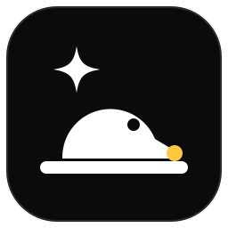
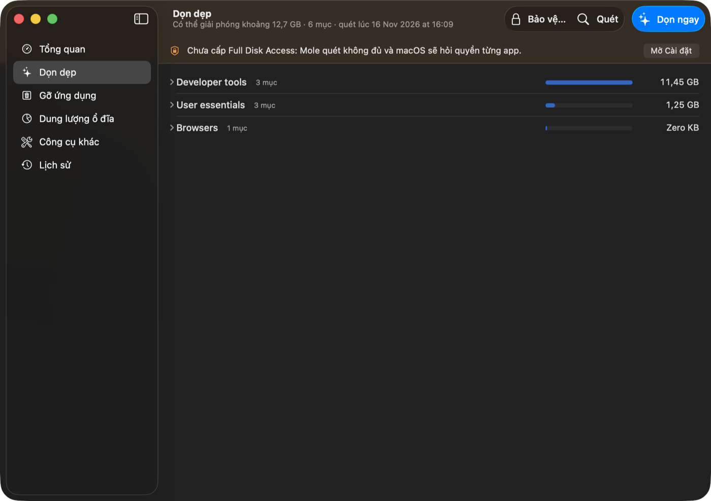
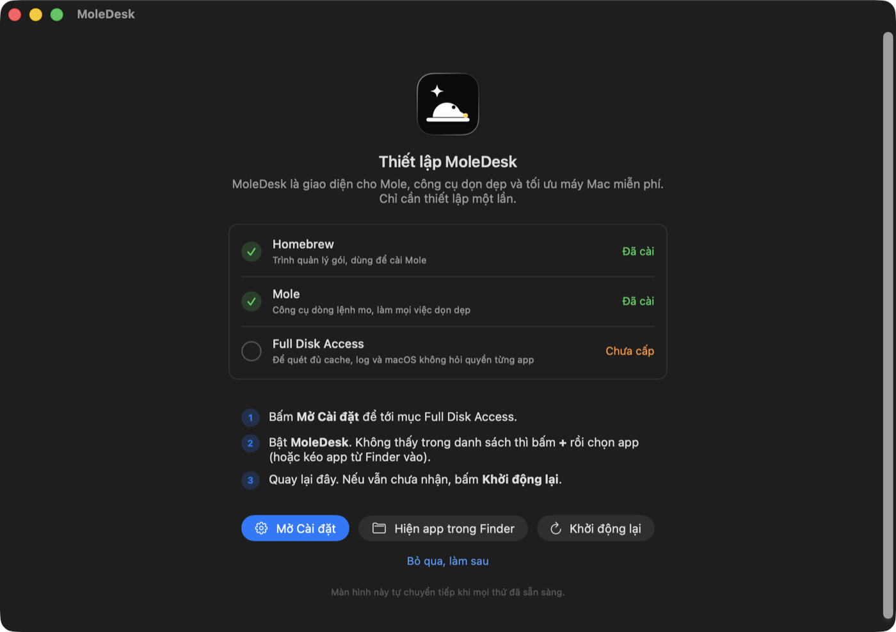

<p align="center"></p>

# MoleDesk

A native macOS GUI for the free, open-source [Mole](https://github.com/tw93/Mole) CLI (`mo`):
clean caches, uninstall apps with their leftovers, explore disk usage and watch system health, from the window or the menu bar.
Not affiliated with Mole or its paid app. The interface is in Vietnamese.

<p align="center"></p>

## Install
1. Download the DMG from the [latest release](https://github.com/cuong95nddev/mole-gui/releases/latest)
   (Apple Silicon and Intel). The app is signed and notarized by Apple.
2. Open it and drag **MoleDesk** onto **Applications**.
3. On first launch the app walks you through `brew install mole` and granting **Full Disk Access**.

Requires macOS 14 or later.

<p align="center"></p>

## What it does
| Pane | Mole command |
|---|---|
| Tổng quan (overview) | `mo status --watch --interval 2s` (NDJSON) |
| Dọn dẹp (clean) | `mo clean --dry-run`, then reads `~/.config/mole/clean-list.txt`; "Dọn ngay" runs `mo clean` |
| Gỡ ứng dụng (uninstall) | `mo uninstall --list` (JSON); actions run `mo uninstall [--dry-run] NAME…` |
| Dung lượng ổ đĩa (disk usage) | `mo analyze --json [PATH]` |
| Công cụ khác (tools) | `mo optimize`, `purge`, `installer`, `slim`, `touchid`, `update` |
| Lịch sử (history) | `mo history --json` |
| Menu bar panel | the same `mo status` stream, shown from the menu bar icon; it runs only while the panel or the overview is open |

Anything that deletes, needs sudo, or asks for confirmation runs inside an embedded terminal
([SwiftTerm](https://github.com/migueldeicaza/SwiftTerm)), so Mole's own previews, prompts and
safety checks stay in charge.

## Build
Needs Xcode 26 (Swift 6.2, for SwiftTerm).

```sh
swift test                      # parser tests
scripts/bundle.sh               # build/MoleDesk.app for this Mac
scripts/install.sh              # build it and copy it to /Applications
UNIVERSAL=1 scripts/bundle.sh   # arm64 + x86_64
scripts/release.sh              # universal DMG in dist/
```

`bundle.sh` signs with a Developer ID or Apple Development identity from your keychain when it
finds one (hardened runtime), else ad hoc. A stable identity keeps the Full Disk Access grant
across rebuilds.

Testing hooks: `open build/MoleDesk.app --args -pane clean` (status|clean|uninstall|analyze|tools|history),
`-analyze /some/path`, `-terminal "history"`, `-simulateMissingMole YES`, `-simulateNoFDA YES`,
`-previewMenuBar YES` (shows the menu bar panel in the main window).
`scripts/shoot.sh PANE out.png` screenshots a pane. Icon: edit `Resources/icon.svg`, then `scripts/icon.sh`.

## Releasing
Bump `VERSION`, then push a tag `vX.Y.Z`. The [release workflow](.github/workflows/release.yml)
builds a universal app, signs it with a Developer ID, notarizes and staples the app and the DMG,
and publishes a GitHub release. A tagged release fails instead of shipping an unsigned app.

It needs these repository secrets (Settings ▸ Secrets and variables ▸ Actions):

| Secret | Value |
| --- | --- |
| `MACOS_CERT_P12` | Developer ID Application certificate + private key, exported as .p12, base64: `base64 -i cert.p12 \| pbcopy` |
| `MACOS_CERT_PASSWORD` | the .p12 export password |
| `MACOS_SIGN_ID` | the identity name, e.g. `Developer ID Application: Name (TEAMID)` |
| `NOTARY_KEY` | App Store Connect API key (.p8), base64: `base64 -i AuthKey_XXXX.p8 \| pbcopy` |
| `NOTARY_KEY_ID` | the API key's ID (10 characters) |
| `NOTARY_ISSUER` | the issuer ID (team keys only) |

Locally, `MOLEDESK_SIGN_ID=… MOLEDESK_NOTARY_PROFILE=… scripts/release.sh` does the same.
